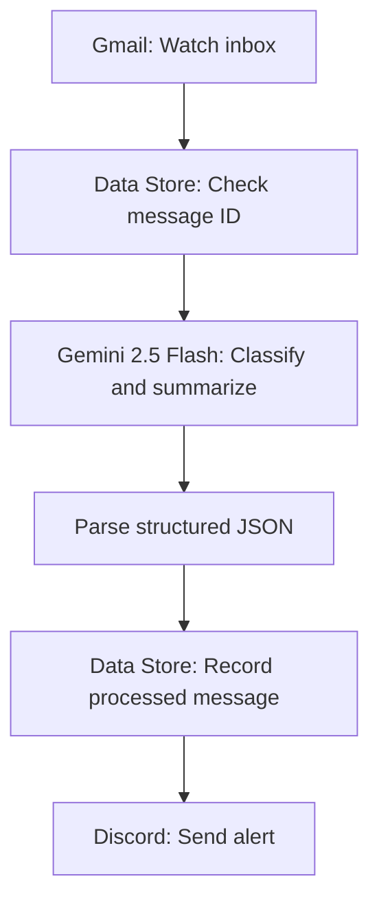

# Gmail AI Email Triage & Discord Alerts

A Make.com automation that uses Gmail and Google Gemini to classify incoming email, summarize what matters, and send a structured notification to Discord. This repository documents the workflow as a portfolio project and includes a sanitized Make blueprint for inspection.

> **Portfolio/demo project:** The included blueprint is sanitized. It is not a one-click, ready-to-run deployment: your own Make connections, Data Store, Gmail labels, and Discord channel must be configured before running it.

## What it does

1. **Watches the Gmail inbox** for new messages.
2. **Checks a Data Store** using the Gmail message ID to help detect messages that have already been processed.
3. **Analyzes email content with Gemini 2.5 Flash** using a structured classification prompt.
4. **Parses the model response as JSON** for predictable downstream handling.
5. **Records the processed message ID** in the Data Store.
6. **Sends a Discord notification** containing a concise summary and classification details.

The prompt asks the model to assign one of these categories:

- Potential Client
- Security Alert
- Important Personal
- Education & Work
- Newsletter & Promotion
- Other

It also requests a priority (`High`, `Medium`, or `Low`), confidence score, attention flag, summary, reasoning, suggested next step, and several supporting flags.

## Workflow overview



The actual Make scenario can include routing and filter behavior that depends on how it is configured in your workspace. Review the imported blueprint and test it with non-sensitive sample messages before using it on a real inbox.

## Tech stack

- **Make.com** — workflow orchestration
- **Gmail** — incoming email trigger and message metadata
- **Google Gemini 2.5 Flash** — classification and summarization
- **Make Data Store** — processed-message tracking
- **Discord** — notification destination
- **JSON** — structured model output between modules

## Repository contents

```text
gmail-ai-email-automation/
├── README.md
├── blueprint-sanitized.json
└── screenshots/
    └── add-your-sanitized-screenshots-here.md
```

## Setup guide

1. Create a new scenario in Make.com.
2. Import `blueprint-sanitized.json` into a test scenario. If your Make account does not accept the sanitized placeholders during import, create the affected modules manually and copy their configuration from the blueprint as a reference.
3. Reconnect the Gmail module using your own Google account.
4. Create a Make Data Store for processed message IDs and select it in the Data Store modules.
5. Configure the Gemini module with your own authorized connection and confirm the selected model is available to your account.
6. Create the required Gmail labels if your scenario uses label actions, then select the correct labels in Make.
7. Reconnect Discord and select a private test channel you control.
8. Review the prompt, filters, router, field mappings, and error handling.
9. Test with synthetic or non-sensitive messages first. Verify the JSON output and Discord message before enabling the scenario for normal use.

**Important:** The placeholders in the sanitized blueprint are intentionally not working connection/resource IDs. Replace them through Make's interface; do not paste real credentials into this repository.

## Security and privacy considerations

- Email can contain private or sensitive information. Use only accounts and messages you are authorized to process.
- Treat incoming email content as untrusted input. The prompt includes instructions not to follow directions embedded in email content, but prompt instructions alone cannot guarantee protection against prompt injection.
- Avoid sending full email bodies, attachments, passwords, verification codes, or unnecessary personal data to Discord.
- Confirm exactly which fields the scenario sends to Discord. This project is intended to send a summary/analysis notification, not to publish an entire email.
- Review the Google, Make, and Discord privacy policies and account permissions before deploying.
- Use a private test channel, least-privilege connections where possible, and a clear retention policy for stored message IDs and logs.
- Do not commit API keys, OAuth tokens, credentials, personal email content, real message IDs, or unredacted screenshots.

## Reliability notes

The Data Store check can help reduce duplicate processing, but it does **not** guarantee exactly-once execution. Concurrent runs, retries, errors between steps, or configuration differences may still lead to missed or duplicate alerts. Add explicit error handling and test the scenario under failure conditions before relying on it.

AI classification can be wrong. Treat the result as triage assistance—not as a security verdict or a replacement for checking suspicious messages carefully.

## Demo evidence to add

Add screenshots to `screenshots/` that show the workflow and a synthetic example notification. Before uploading, crop or blur:

- Gmail addresses, names, subjects, message bodies, and message IDs
- Discord server/channel names or IDs if you want them private
- Make connection names, workspace details, scenario IDs, Data Store IDs, and Gmail label IDs
- API keys, tokens, or any credential-like value

Suggested screenshots:
1. `workflow-overview.png` — the Make scenario modules and routes.
2. `sample-discord-alert.png` — a notification generated from a fictional test email.
3. `sample-classification.png` — example structured JSON using invented content.

No screenshots are included yet; add your own sanitized evidence before publishing.

## Limitations

- Results depend on the quality of the source email and the model's classification.
- The automation requires valid Make, Google/Gemini, Gmail, and Discord connections.
- Model availability, Make module behavior, and service quotas can change.
- The included blueprint reflects one configuration snapshot; verify every module after import.

## Future improvements

- Add confidence thresholds and a review path for uncertain classifications.
- Add explicit error handling, retries, and failure notifications.
- Add a configurable allowlist/blocklist for senders and domains.
- Add tests using synthetic email fixtures.
- Add a dashboard for category and priority trends without exposing message content.

## Author

Built as a hands-on automation portfolio project while learning Python, workflow automation, and practical AI integration.

If you are evaluating this project, feedback on privacy controls, reliability, and workflow design is welcome.
