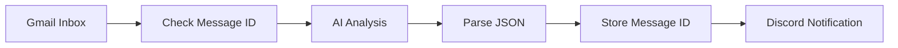

# Gmail AI Email Automation

An AI-powered email assistant that classifies incoming Gmail messages, summarizes important information, and sends organized notifications to Discord.

**Built with:** Make.com · Gmail · Google Gemini 2.5 Flash · Discord

## Overview

Managing a busy inbox can be time-consuming. This project uses AI to help identify important emails, understand their purpose, and deliver concise summaries where they are easy to review.

## Key Features

- **AI Email Classification** — Categorizes emails into Potential Client, Security Alert, Important Personal, Education & Work, Newsletter & Promotion, or Other.
- **Priority Detection** — Assigns High, Medium, or Low priority.
- **Smart Summaries** — Generates a short explanation and suggested next step for each analyzed email.
- **Discord Notifications** — Sends structured email alerts to a Discord channel.
- **Duplicate Processing Check** — Uses stored message IDs to help avoid processing the same email repeatedly.

## How It Works

1. Gmail detects incoming messages.
2. Make.com checks whether a message ID has already been recorded.
3. Google Gemini analyzes and classifies the email.
4. The AI response is parsed into structured JSON.
5. The message ID is stored for future checks.
6. A notification is sent to Discord.

## Technologies Used

| Technology | Purpose |
|---|---|
| Make.com | Workflow automation |
| Gmail | Email source |
| Google Gemini 2.5 Flash | AI classification and summarization |
| Make Data Store | Message tracking |
| Discord | Notifications |
| JSON | Structured AI output |

## Project Structure

- `blueprint-sanitized.json` — Sanitized Make.com workflow blueprint.
- `screenshots/` — Visual examples of the workflow and its output.

The blueprint is provided for portfolio review. It may require your own connections and configuration before it can run.

## Privacy & Reliability

The workflow is designed to send email analysis and summaries to Discord rather than intentionally sharing the full email body. Always verify which fields your scenario sends.

AI-generated classifications may be inaccurate, and message tracking helps reduce duplicate processing but does not guarantee that every email will be processed exactly once. Review important or suspicious emails yourself.

**Never publish credentials, private email content, or personal information in this repository.**

## About This Project

This project demonstrates practical AI integration, workflow automation, and structured data processing to solve an everyday productivity problem.

I built it as part of my ongoing journey in automation, Python development, and cybersecurity.
